# CY300 Spaceflight

A rocketry and spaceflight game in the making, written in Python on top of
OpenGL 4.5 as a CY300 course project. Its engine renders with physically
based materials, cascaded shadows and image-based lighting, and streams the
bodies of the solar system as they were measured (real elevation and color
maps) under physically based atmospheres, on real orbits with a real clock.
You fly a two-stage rocket off any body: real-scale parts, gravity, thrust,
drag in the real air, staging, orbits followed exactly under time warp,
patched conics to the Moon and back or out to Mars, a map of your orbit with
maneuver nodes, transfer windows and course corrections, reentry heating, and
a capsule that comes home behind its heat shield and under its parachute; or
build your own rocket in the part editor, on the pad.

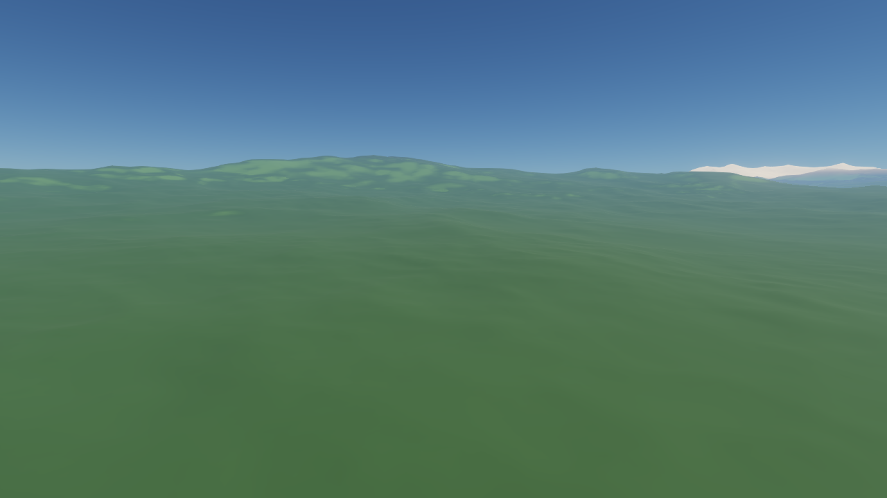

## Features

**Planets**

- Cube-sphere planets at full size: measured heights and colors where the
  body has been mapped, seeded noise (continents, ridged mountain ranges,
  hills) for the rest; biomes, snow and sea ice from an analytic climate
- Quadtree level of detail per cube face with horizon culling; chunks are built
  on worker threads and streamed in coarse-to-fine without holes or cracks
- Planet-aware camera: radial "up", altitude-scaled flying speed, stays above
  the terrain

**Bodies of the solar system**

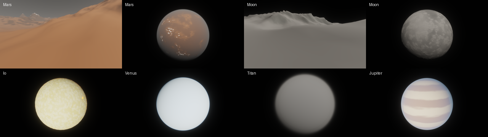

- Body profiles (`assets/bodies/*.json`, real data from NASA's fact sheets) for
  Mercury, Venus, Earth, the Moon, Mars, Phobos, Deimos, Vesta, Ceres,
  comet 67P, Jupiter, Io, Europa, Ganymede, Callisto, Saturn, Enceladus,
  Titan, Uranus, Neptune, Triton, Pluto and Haumea:
  size, mass, rotation, tilt, orbit, star, temperature, surface liquid and
  colors, terrain relief, atmosphere (pressure, gases, aerosols), maps
- Physics derived from them: surface gravity, sunlight, equilibrium and
  greenhouse temperature, atmospheric scale height (H = RT / Mg), lapse rate
  (g / cp, less in moist or thin air), light scattering from pressure and gas
  mix, colored dust and haze, the star's color from its temperature, the
  sun's apparent size and (compressed) brightness
- Liquids and ices from phase physics (triple and critical points, vapor
  pressure curves): seas of water or methane freeze where colder than their
  freezing point and boil away (leaving dry basins) when hotter than their
  boiling point at the surface pressure; no liquid at all below the triple
  point (water on Mars). Ice caps of water, carbon dioxide, nitrogen or
  methane form below the frost point set by the gas's partial pressure
  (Mars's water-ice caps at ~-76 C, Pluto's and Triton's nitrogen ice).
  Life is a switch: without it, the same climate zones are bare ground
- Travel (pause menu) starts over at any of them
- Dry worlds keep their basins, methane seas (Titan), glowing lava lakes
  (Io), mineral surface palettes, gas-giant cloud bands, and a black sky with
  hard shadows where there is no air
- Add a body by writing a new profile file; the loader validates it

**Gas and ice giants**

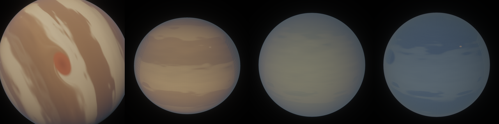

- Flattened by their spin: cloud tops on an ellipsoid (Jupiter 6.5% wider
  at the equator, Saturn ~10%); the atmosphere, clouds and lighting work in
  a stretched space where the ellipsoid is a sphere, so the haze and limb
  follow the shape exactly
- Weather per pixel: belts and zones of irregular width, festoons and
  streaks where the jet streams shear, the great storms swirling the bands
  around them (Jupiter's Great Red Spot, Neptune's Great Dark Spot), strings
  of white ovals, Saturn's hexagonal north polar jet
- No ground: fly down through the cloud tops into the decks below (see
  the next section)

**Descending through thick air**


- The air column follows its physics (`planet/air.py`): rocky worlds cool by
  their lapse rate up to a tropopause at the radiative skin temperature
  (Earth: 0.265 bar at 10 km, as in the standard atmosphere); below a giant's
  tops the gas convects, heating along the dry adiabat (Jupiter ~2 K/km;
  ~470 K and ~17 bar 150 km down, close to the Galileo probe's numbers). The
  HUD shows the pressure and temperature around the camera
- Cloud decks as layers of the air, placed where their gases condense:
  Venus's sulfuric-acid haze and cloud decks (31-90 km, optical depth ~28);
  Jupiter's and Saturn's ammonia, ammonium hydrosulfide and water clouds;
  Uranus's and Neptune's methane, hydrogen sulfide and water clouds. They
  are part of the scattering lookup tables, so they light consistently from
  orbit and from inside
- From inside, the decks are patchy (3D noise at each deck's own scale,
  averaging out so it does not change the light); the raymarch splits rays
  at the decks' boundaries and spends its samples by optical depth
- Light dims with depth as it really does: thick cloud passes most light on
  diffusely rather than stopping it (two-stream transmission), so under
  Venus's clouds it is a dim, shadowless orange day; deep in a giant the
  sunlight runs out entirely
- Heat you can see: the deep air of a giant glows by its temperature
  (blackbody color and brightness, in the same units as sunlight: dull red
  past ~1100 K, orange by ~1500 K) down to the bottom of the model at 3000 K
- Lightning in the water clouds: storm cells flash on their own clocks, a few
  strokes each, lighting the cloud around them; seen from above, glows
  spreading through the deck
- The model's bottom (where the air reaches 3000 K, ~1400 km down on
  Jupiter) is only where drawing stops: there are no entry effects, drag,
  heating or crush depth, left for a game built on top to define
- Not drawn: Venus's superrefraction (its dense air bends light enough to make
  the horizon curve up like a bowl), since the haze hides everything beyond
  a few km, where the effect would only shift the horizon by ~2 m

**Rings**

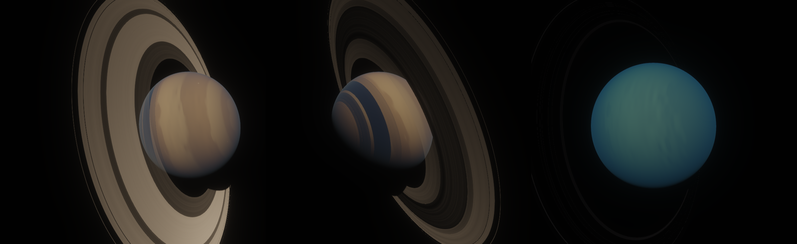

- Ring systems in the equatorial plane from the profiles: Saturn's C, B and
  A rings, the Cassini Division, the Encke Gap and the F ring; Uranus's
  narrow, coal-dark rings; Neptune's faint ones; each band made of fine
  ringlets
- Lit as a layer of icy particles (single scattering with backscattering
  particles and a forward-scattering glow): dense rings bright on their lit
  face and dark from below, sparse ones glowing from behind
- The planet's shadow falls across the rings, and the rings' shadow bands
  across the planet (and its haze)

**Shapes**

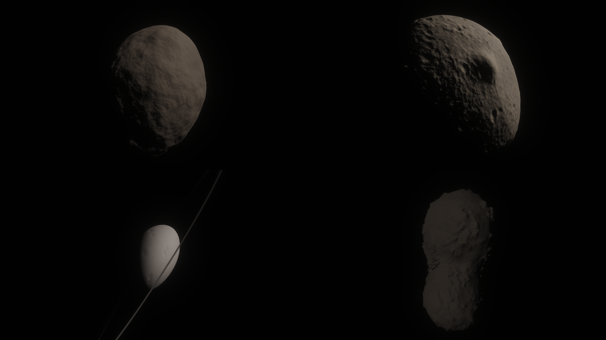

- Relief stands on a base shape instead of a sphere: every body is
  flattened by its spin (Jupiter 6.5%, Ceres 7.5%, Earth 0.3%), and the
  seas follow the flattened surface
- Irregular small bodies: triaxial ellipsoids (Phobos 27 x 22 x 18 km, its
  long axis toward Mars; Haumea stretched by its 3.9-hour spin into an egg
  twice as long as it is thick), large-scale lumps, contact binaries of two
  lobes joined by a smooth neck (comet 67P), and giant impact basins as big
  as the body (Stickney on Phobos, Vesta's Rheasilvia with its 20 km
  central peak)
- Slopes are measured against the shape (a plain on a potato's flank is not
  a cliff); level of detail, horizon culling and the camera's ground all
  follow it; small bodies are first seen whole from space

**Orbits, the clock and eclipses**

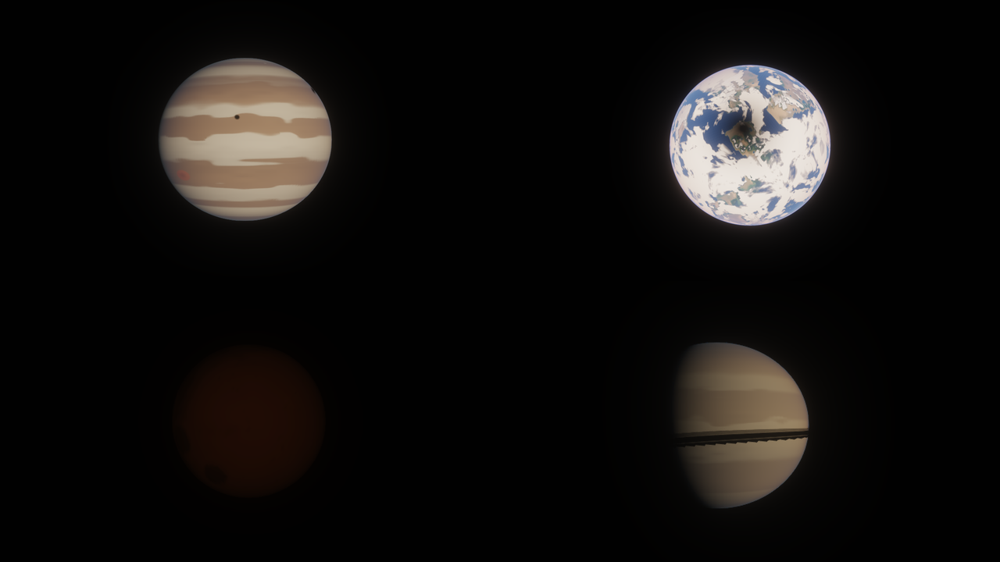

- A simulation clock (time warp from real time to ten million times faster)
  drives everything: planets on Keplerian orbits
  from JPL's mean elements, moons around their planets, and every body's
  spin from its IAU pole and prime meridian, so the sun's direction, day
  and night, the seasons and the equation of time follow from the date
  (12:00 UTC is solar noon at Greenwich, give or take a quarter hour; on
  Venus and Uranus, which spin backwards, the sun rises in the west and
  local time still runs forward)
- The Moon follows the main terms of its own theory (the Sun's pull,
  precessing nodes): eclipses fall on their real dates. New planets bring
  their planetary system: Earth its Moon, Mars Phobos and Deimos, Jupiter
  its Galilean moons, a moon its planet and siblings
- The body the camera is nearest stays put while the sky wheels around it,
  so the ground never slides away; flying to another body hands over
  seamlessly
- Eclipses from the overlap of the sun's disc with every other body's:
  penumbra, umbra and annular phases, the sky darkening in a total solar
  eclipse, Earth's air bending red light onto the eclipsed Moon, moons'
  shadows crossing Jupiter. Moons and planets in the sky have their own
  air drawn as seen from afar (Earth's blue limb and clouds from the Moon)
- The star's brightness, color and apparent size follow the live distance;
  chunk building is shared across all the bodies at once, every body whole
  first, then detail where it looks largest

**The night sky and space**

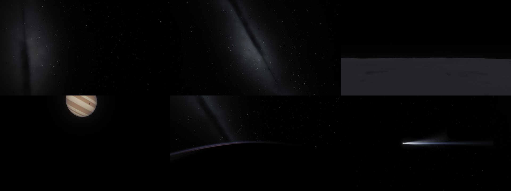

- The real stars: all 9,110 of the Yale Bright Star Catalog (to magnitude
  6.5, everything the eye sees), at their positions, brightness and colors
  (from their B - V color index), so the constellations rise and set with
  the clock; they twinkle through air, more near the horizon, and the air
  dims them and the day sky drowns them. `python tools/fetch_stars.py`
  downloads the catalog (574 KB); without it the sky gets random stars
  with the same counts
- The Milky Way: its band brightest toward Sagittarius, the Cygnus and
  Carina star clouds, the yellowish bulge below the dust of the Great
  Rift, the Coalsack, the Magellanic Clouds and the Andromeda galaxy, in
  galactic coordinates (baked once into a map)
- The planets and moons too far to show a disc are points of light that
  move against the stars, as bright as they really are (their size,
  albedo, distance and phase: Jupiter at opposition magnitude -2.7, the
  full Moon -12.4)
- Light between bodies (planetshine): a sunlit neighbor lights a night
  side by its size, albedo and phase. The Moon's night side in earthshine,
  Io under a full Jupiter, moonlight on Earth
- All of it at its physical brightness (a star ~1e-10 of sunlight), seen
  the way the eye sees it: auto exposure dark-adapts as the light fades,
  up to a million times, so in the dark the stars and the Milky Way come
  out, while a sunlit planet in view outshines them as in any photograph;
  night scenes stay dim, and faint light turns grey-blue (rods instead of
  cones). (The HDR image is 32-bit float for it: starlight is below half
  floats' range)
- Comets come alive near the Sun: a coma and two tails, from the dust
  activity measured for each (A f rho, growing ~r^-3.5 inside ~4 AU): the
  broad dust tail curving back along the orbit, brightest seen toward the
  Sun, and the straight blue ion tail. 67P (next perihelion 2028) stays
  faint, as Rosetta saw it; Halley's Comet (new: its 1986 and 2061
  returns) grows tails millions of km long

**Real maps**

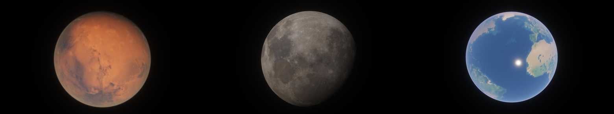

- Every body that has been mapped is shown as measured, by default:

  | Body | Heights | Colors |
  | --- | --- | --- |
  | Mercury | MESSENGER stereo DEM, 665 m | MESSENGER MDIS basemap (its enhanced color toned down to true greys) |
  | Venus | Magellan radar altimetry, 4.6 km | |
  | Earth | ETOPO1, land and sea floor (1.8 km up close) | Blue Marble Next Generation, July |
  | Moon | LRO LOLA (0.5 km up close) | LROC WAC mosaic |
  | Mars | MGS MOLA (0.9 km up close) | Viking color mosaic |
  | Ceres, Vesta | Dawn HAMO stereo DTMs (~140 m, ~90 m) | |
  | Io, Europa, Ganymede, Callisto | | Galileo SSI and Voyager mosaics |
  | Titan, Enceladus | | Cassini ISS mosaics |
  | Triton | | Voyager 2 mosaic |
  | Pluto | New Horizons stereo DEM, 300 m | New Horizons mosaic |

  `python tools/fetch_maps.py` downloads them (~4.4 GB, from NASA, NOAA and
  USGS Astrogeology; public domain or free to redistribute) into
  `data/maps/`; they are not part of the repository. Without them a body
  falls back to its generated surface
- Each map is read in its archive's own format (PDS images and labels,
  classic netCDF, GeoTIFFs with their scale, offset and projection, images),
  resampled once onto the cube-sphere and cached (loads in milliseconds);
  hills and craters smaller than the map can show are added on top. Areas
  never imaged (Pluto's and Triton's far sides, Venus's gaps) are filled
  smoothly from around them. Heights measured from a sphere carry the
  body's whole shape (Ceres's flattening, Vesta's giant basins) and are
  taken as that
- Sharper data up close: the full-resolution GeoTIFFs, Mars at 64
  pixels/deg (four MOLA tiles), the Moon at 64 pixels/deg, Earth every
  arc-minute (`python tools/fetch_maps.py --sharp`, ~1.5 GB for those three).
  They are memory-mapped, never loaded: only the samples the detailed chunks
  near the camera need are read from disk, blended in over a factor of two
  in detail so nothing pops
- Color mosaics too large for a texture (up to 23,040 x 11,520) are averaged
  down once to 4096 x 2048 images in `data/cache/`
- The clock turns the real continents to the sun at the right hours

**Impact craters**

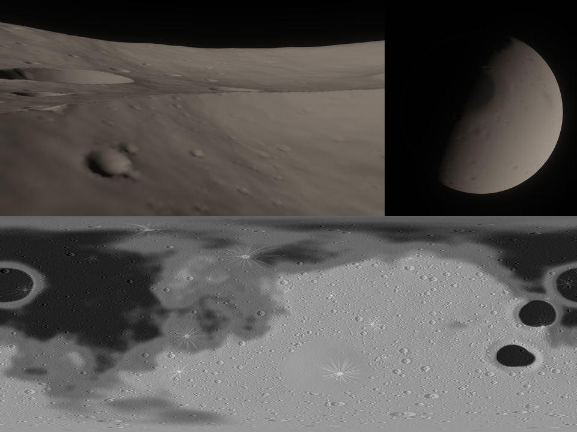

- Craters at every size from ~150 km down to tens of meters, evaluated per
  vertex like noise (a seamless 3D lattice per size octave), so they appear
  at any level of detail
- A realistic size mix (N(>D) ~ D^-2) and a count that follows the surface's
  age (each body's own), by the lunar cratering chronology with its
  heavy bombardment: saturated lunar highlands, sparser maria, nearly blank
  Io and Europa
- Simple bowls below a transition diameter that shrinks with gravity (Moon
  ~15 km, Mars ~7 km), flat-floored complex craters with central peaks
  above; raised rims, ejecta blankets, older craters worn shallower
- Air burns up small impactors (Venus: nothing under ~3 km); rain and
  methane weather erase old craters (Earth, Titan)
- Young craters on airless bodies throw bright, lopsided ejecta rays
- Each body has its own seed (its own basins, maria and craters)

**Erosion: dunes and gullies**

- Wind-blown dunes where air can move sand and the ground is dry:
  transverse crests with steep slip faces across the wind (Earth's deserts,
  Mars's dark basaltic fields), long linear ridges along it in Titan's
  equatorial belt of dark organic sand; active dunes bury the craters under
  them
- Carved slopes: gullies cut straight down every slope, joining into
  valleys, the ridges between left sharp (an "erosion filter": stripes along
  the slope at each scale from 2.4 km to 130 m, each finer octave following
  the slope the coarser ones left, so small gullies run into big ones);
  where rain runs off (Earth, Titan), half as much on Mars (its ancient
  valley networks), a little on Venus, none on airless worlds; over a
  measured map only what it is too coarse to show

**Close to the ground**

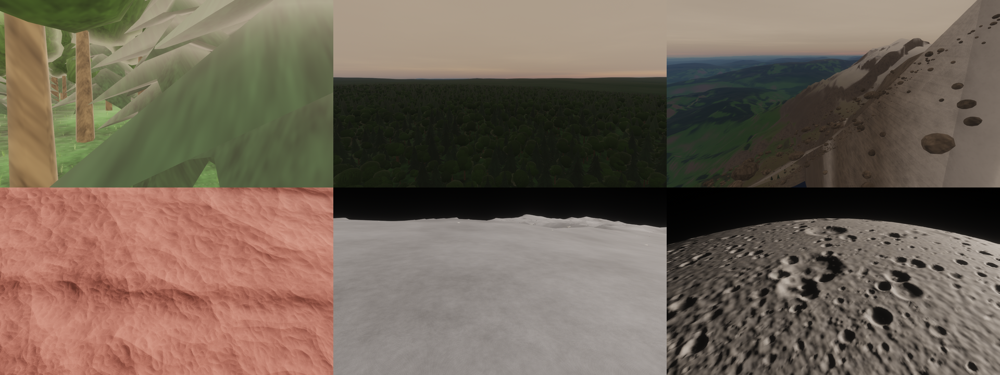

- Rocks, boulders, trees and grass, placed per cell of the cube-sphere grid
  around the camera from the same terrain and climate the ground is shaded
  by: conifers where it is cold, beeches and oaks in temperate forest, tall
  dark rainforest trees, flat-topped acacias on the savanna (life-bearing
  worlds only); grass tufts, green where wet and straw where dry; boulders
  everywhere bare, most of all in scree under cliffs, many small and few
  large, settled into the slope. Placement is deterministic per cell
- Drawn instanced: each layer one buffer of instances sorted into blocks,
  one multi-draw per layer for the blocks in view (trees switch to cheap far
  shapes past 160 m), lit and shadowed like everything else; they grow in
  over the last part of their reach, and sway in the wind. Built on the
  workers after the terrain (it streams first). Off at Low graphics
  quality
- Ground texture all the way down: below the terrain's finest vertices each
  material has its own detail to ~5 cm: rock cracked and blocky with strata
  on cliffs, sand smooth with ripples across the wind where there is air,
  regolith and soil grained, plants patchy, snow faintly wind-carved; fading
  as it gets smaller than a pixel (its relief sooner, so bump lighting never
  aliases)
- Exact up close: the noise is measured from a planet-fixed grid point near
  the camera (32-bit positions from a planet's center blur below ~0.5 m) and
  is gradient noise with a strong hash (value noise lights its lattice
  planes as lines); chunk edges are stitched to the vertices a coarser
  neighbor shares, so there are no cracks
- Mountains' shadows: beyond the cascades (which now reach a few hundred
  meters near the ground, for trees and rocks), one more shadow map covers
  the land in view, from ~20 km around on the ground to ~1,500 km from orbit:
  crater floors in shadow near the Moon's terminator, valleys in shade at
  sunrise. Redrawn only when the view or the sun has moved

**Climate and biomes**

- An analytic annual-mean climate, no simulation: each body's measured mean
  temperature, spread from equator to poles by how much its air evens heat
  out (~45 C on Earth, ~60 C with no air, ~10 C under Venus's or Titan's
  thick air), colder with height by the body's own lapse rate
- Rain in Earth's latitude belts: the wet tropics and storm tracks, the dry
  subtropics and poles, patchy with noise
- Biomes from temperature and rainfall (a Whittaker diagram): ice, tundra,
  taiga, temperate forest, grassland, desert, savanna, tropical rainforest;
  snow and tree lines follow temperature, so they fall with latitude and rise
  with warmth

**Clouds**

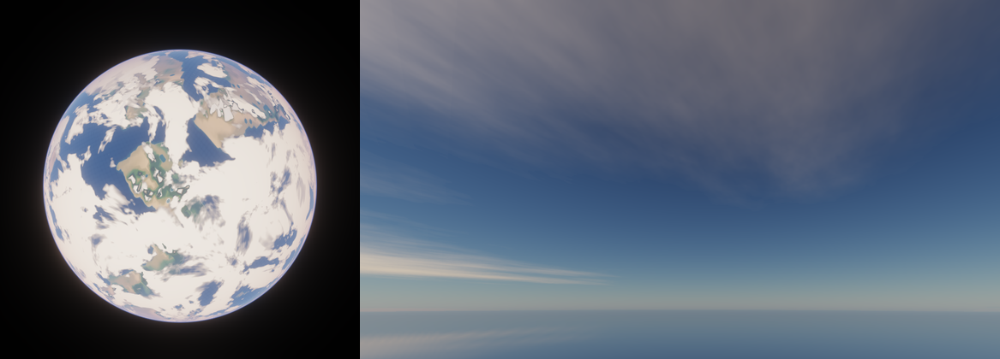

- A weather cloud layer in the rain belts: the equatorial belt and the
  storm tracks cloudy, the subtropical deserts clear, the planet averaging
  its observed cover (Earth ~55-65%); domain-warped fractal noise per pixel
  shapes the clouds from continent-sized systems down to tens of meters,
  drifting slowly with the winds
- Drawn inside the atmosphere pass: air in front of the clouds, the clouds,
  and the sky behind their gaps; bright tops from above, dark bases from
  below (two-stream light through thick cloud), reddened at sunset, glowing
  at thin edges toward the sun
- Clouds shadow the ground, and overcast skies dim the ambient light
- Per body: Earth's water clouds, Mars's rare thin water-ice clouds, Titan's
  methane clouds; Venus's sulfuric acid deck hides its surface completely

**Atmosphere**

| Sunset from 12 km | From orbit |
| --- | --- |
| 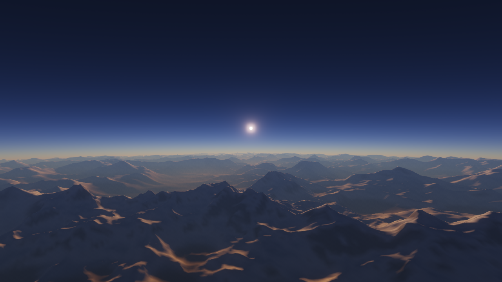 | 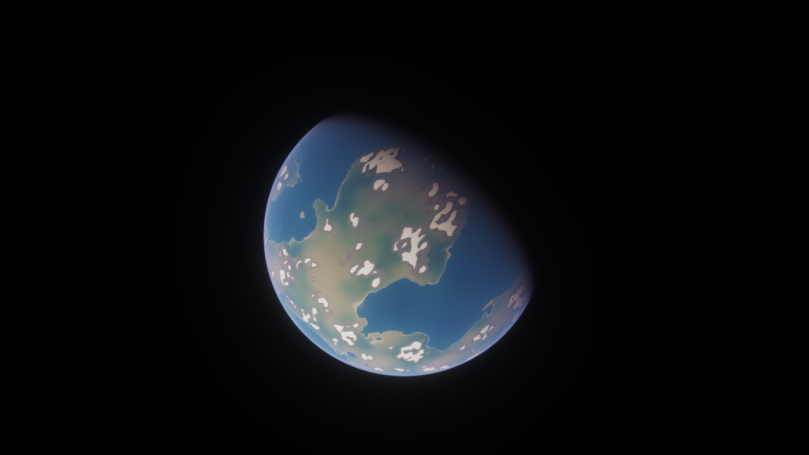 |

- Rayleigh, Mie and ozone scattering with multiple scattering (Hillaire 2020):
  transmittance and multiple-scattering lookup tables, then a raymarch per pixel
- Blue sky, sunsets, haze over distant terrain, and the planet's limb seen from
  space, from the same model and Earth's physical constants (all editable)
- Sunlight reaching every surface is filtered by the air above it: low sun
  turns orange, the night side goes dark
- Aerosols near the ground (dust, haze) or in a deck at altitude (Venus's
  sulfuric acid clouds at ~57 km, with clearer air below)
- Colored aerosols (per-channel scattering and absorption): Mars's
  butterscotch dust, Titan's orange haze
- Optically thick atmospheres (Venus's clouds, Titan's haze) pass diffuse
  daylight down to the ground (a two-stream estimate baked into a third lookup
  table), so their surfaces are dimly lit instead of black
- Ambient lighting and reflections baked from the atmosphere at the camera

**Rendering**

- Physically based shading (Cook-Torrance GGX, metallic-roughness as in glTF 2.0)
  with base color, metallic-roughness, normal, occlusion and emissive maps
- Directional, point and spot lights
- Cascaded shadow maps that follow the camera (stabilized against shimmering),
  plus spot light shadows, filtered with hardware PCF; a terrain shadow map
  far and wide on planets
- Procedural sky for scenes without a planet; ambient light and reflections baked from it
  (split-sum image-based lighting: irradiance, prefiltered specular, BRDF LUT)
- HDR pipeline: bloom, exposure with eye adaptation (dim scenes such as
  Titan's surface brighten, glaring ones darken, over half a second; views
  of a planet from space keep their exposure), ACES / Reinhard tone mapping,
  gamma correction, FXAA
- Close-up terrain detail: per-pixel fractal noise varies the ground's
  brightness and hue and adds micro-relief bump shading, fading out with
  distance so it never shimmers; bare worlds' regolith is mottled at every
  scale
- Batched drawing: one shared geometry buffer, one multi-draw-indirect call per
  material, frustum culling of every object and shadow caster
- Planet-scale precision: 64-bit world positions, camera-relative rendering and
  a reversed-Z infinite depth buffer
- OBJ and glTF / GLB model loading, including glTF materials and embedded textures
- Shader `#include`s and hot reload (edit a `.glsl` file while the engine runs)

**Vessels and flight**

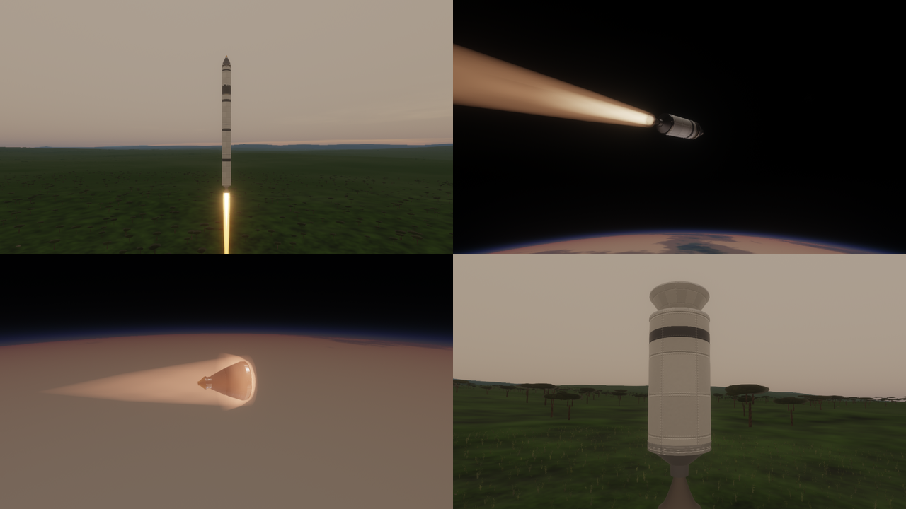

- How parts look (`vessel/looks.py`): each one lathed from profiles
  (`MeshFactory.lathe_data`: a profile turned about the stack's axis,
  creased at sharp corners) in a few pieces and finishes: tanks' painted
  skins between bare metal rings, with panel seams and rivet rows and a
  dark roll band on the long ones; engines' mounts, chambers and bells
  (dark inside); an ogive nose; a parachute's packed dome; a capsule's bowed
  cone with its window band; a heat shield's charred, pitted face; a probe
  core's gold foil; dishes; the habitat's soft bulging shell. A separator
  under an engine is an interstage: a skirt round the engine, gone with the
  separator when it fires. The surfaces (hull panels, foil, ablative) are
  generated by `tools/generate_assets.py`
- Glowing gas (`GlowComponent`, `glow.frag.glsl`, added over the scene so it
  blooms): exhaust in two layers, a bright core inside the flame, narrowing
  in thick air and spreading wide in vacuum, longer with the throttle,
  flickering; coming in through the air, a bow shock round the end meeting
  it and a wake behind, orange turning pink-white as the heat flux grows
- Parts (`assets/parts/parts.json`) and vessels built from them
  (`assets/vessels/`), at real scale in SI units: a crew capsule with
  reaction wheels, a 30 m main parachute, kerosene / oxygen tanks, a booster
  engine (2.2 MN, Isp 285 s at sea level and 315 s in vacuum) and a vacuum
  engine (250 kN, 348 s), stage separators. Pathfinder, the starting rocket:
  160 t, 37 m, ~10.3 km/s of delta-v; stages: booster, upper stage, capsule
  separation, parachute. It makes low Earth orbit with ~650 m/s to spare
  (the tests fly it there with simple guidance)
- Flight physics (`vessel/physics.py`) in the body's non-rotating frame:
  gravity, thrust whose push falls with the outside pressure (Isp), drag
  through the air (density from the body's air column, the air turning with
  the body), propellant burned per engine from its own section's tanks;
  steering by reaction wheels and the engines' gimbals, against the stack's
  moments of inertia, with stability assist holding the attitude
- The ground: launch from a pad turning with the body, land below the
  bottom part's crash speed, or be destroyed above it
- Coasting above the air, the orbit is followed exactly (universal-variable
  Kepler propagation): time warp to 10,000,000x. Under thrust, in the air or
  near the ground physics steps every 0.02 s and warp stops at 5x; a
  falling arc goes on rails in pieces short enough not to pass through the
  ground
- Staging (**Space**): the first stage lights the booster; the next fires
  the separator, drops everything below it and lights the upper engine; then
  the capsule separates, and the last arms the parachute. Spent stages fall
  away as debris (gravity and drag) until they hit the ground or are left
  25 km behind; the vessel goes on from its new bottom without a jump
- Parachutes open once the air is thick enough and slow enough (below
  250 m/s), over three seconds; the capsule then hangs nose-up under the
  canopy and lands at ~9 m/s at sea level (its limit is 10); it opens in
  air down to 0.004 bar, so it works in Mars's thin air too
- Reentry heating (`vessel/heating.py`): fast through the air, the part
  meeting the flow heats (Sutton-Graves stagnation flux, k sqrt(rho / r_n)
  v^3: ~1.6 MW/m^2 back from low orbit), every part a little along its side
  at an angle; each part's skin has its own temperature, radiating its heat
  back out (sigma eps T^4). Past its limit (1,400 K for most parts) the part
  burns up and takes the vessel with it. The heat shield under Pathfinder's
  capsule (rated 3,300 K) peaks ~2,400 K coming back from low orbit and
  ~3,000 K from the Moon; nose first, or without one, the capsule burns up.
  The HUD shows the hottest part against its limit; the part editor warns
  of a capsule with no shield
- Patched conics (`vessel/soi.py`): the vessel feels one body at a time,
  the one whose sphere of influence it is in (the Moon's ~66,000 km, Earth's
  ~925,000 km; the Sun beyond). Crossing a boundary hands it over, its state
  re-expressed about the new body; time warp slows ahead of a boundary so
  the handover is never skipped (judged by the speed between vessel and
  body, so a planet met at a few km/s does not slow the clock from afar).
  Earth to the Moon and round it (a gravity-assisted swing back out) works
  on rails at full warp
- The whole solar system is in the scene: every planet, moon and small body
  on its real orbit, each with its sphere of influence, so you can fly from
  one to another. Bodies far away cost little: a planet too small in the
  view to see detail on sleeps (no terrain streamed), and distant air,
  rings, shadows and eclipses are drawn only for bodies big enough in view
  to matter
- Interplanetary transfers (`vessel/transfer.py`): with a planet targeted
  from orbit round another, the map's navigation panel finds the cheapest
  departure window in the next synodic period (Lambert's problem solved
  across departure dates and flight times, on the planets' real eccentric,
  inclined orbits), the burn there and now, where in the parking orbit to
  burn (a "Burn here" marker on the map), the flight time and the speed
  you arrive at. Earth to Mars: ~3.6 km/s from low orbit, ~250-290 days
- Round the Sun with a planet targeted: the closest approach on the
  predicted path and a course correction (a Lambert solve to the target at
  the cheapest arrival round it), offered as a maneuver node; once the path
  enters the target's sphere it shows the encounter and how close it
  passes. A Mars voyage played through in the game (window, escape burn,
  one ~150 m/s correction) arrives on a ~100,000 km flyby
- Maneuver nodes (`vessel/maneuver.py`, the map's Maneuver panel): plan a
  burn at the apoapsis, the periapsis or a few minutes ahead, then move it
  (by steps, or to an apsis) and drag its prograde / normal / radial parts;
  the path after it is drawn in green with its own Ap / Pe and encounters,
  and the panel shows what it costs (m/s against the delta-v left, burn
  time at full throttle by the rocket equation, stage by stage) and what
  the orbit becomes. Time warp slows to arrive 15 s before the burn should
  start (half its length before the node); "Warp to it" goes as fast as
  allowed until then. The **F** SAS mode "maneuver" points the nose along
  what is left of the burn (the thrust's own velocity change is counted,
  not gravity's), the HUD counts down to the burn and then what is left,
  and the throttle is cut when it is done
- Suggested burns, one click to a node: circularize at either apsis;
  coming in to a planet or moon, capture at the periapsis (circular, or a
  cheaper long orbit); come down from orbit, the periapsis into the air
  (where it is ~0.002 bar: Earth ~41 km, Mars ~10 km) or, airless, to the
  ground; with a target, the window's burn over the marker and the course
  correction
- Landing on engines (airless or thin air, below 60 km): the HUD shows when
  to start braking (the full-throttle burn that just stops at the ground)
  and when the ground comes without it. The impact is found on the real
  terrain along the path ahead (the elevation map sampled under the
  predicted track, the body turning meanwhile), not the ground below now
- Touching down (`vessel/landing.py`): the vessel stands on its landing
  legs' pads (**G** lowers them; a small leg's pad 1.4 m out, a large
  one's 2.6 m) or, without them, the bottom of its lowest part (an engine
  bell, a heat shield). Faster than what it lands on stands (legs 12-14
  m/s) it breaks up. Otherwise it settles square to the ground: the slope
  comes from the real heights and the fine detail on them, sampled round
  the touchdown point. It tips over if the slope is steeper than its feet
  hold (its center of mass past their edge: Mariner's lander stands on 44
  deg with its legs down, 13 on its bell), if it comes down tilted past
  that, or if it slides sideways hard enough to roll over its downhill
  feet (about 1.7 m/s on the Moon, more in stronger gravity). On its side
  it cannot lift off again but can still do its science and report (as
  IM-1 Odysseus did in 2024); a tall vessel falling over in strong gravity
  breaks up. Below 3 km the HUD shows the slope below and the slope it
  stands on (amber when too steep, a reminder when its legs are up); chips
  for the legs and for lying on its side; the part editor shows how the
  last stage stands. Radial groups can be turned round the core (`angle`
  in a design): Mariner's four legs stand between its two wings
- Prograde and retrograde follow the motion over the ground below 30 km
  (and in air), so retrograde points straight up for a vertical landing
- Attitude control works coasting too: SAS and the pilot's keys turn the
  vessel in orbit at time warps up to ~2 s a frame; faster, on rails, it
  holds still
- Map view (**M**): the camera pulls back round the body; the vessel's path
  ahead is drawn over the view, patch by patch (its orbit, or its arc to the
  ground, or out of the sphere; an encounter's flyby round the moon it
  reaches, with its closest approach), Ap / Pe with heights, the moons'
  orbits; a maneuver node and the path after it; lines dim where the body
  hides them
- Attitude ball (navball) beside the vessel panel: sky and ground about the
  local horizon, the compass points, heading and pitch, and markers for
  prograde / retrograde, normal / anti-normal, radial in / out, the
  maneuver node's burn and the target (a vessel or a body; an arrow on the
  rim points the way when it is behind the ball).
  Stability assist (**T**) holds the attitude, or (**F**) points prograde,
  retrograde or along the maneuver node's burn
- Chase camera round the vessel (right mouse, scroll); **V** switches to the
  free camera
- One look for every panel (`game/style.py`): shared colors with a meaning
  (good, warning, bad, funds, science), spacing, rounded translucent panels,
  bold headings, fixed-width digits so numbers do not jitter, bars and
  colored state chips
- Vessel HUD at the bottom centre: the name and a situation chip (landed,
  flying, sub-orbital, orbiting, flyby, escaping) and the body; Propulsion,
  Motion and Orbit columns: throttle, propellant, stage, thrust to weight,
  delta-v left, surface / orbital / vertical speed, apoapsis and periapsis,
  SAS mode, parachute, the maneuver node's countdown, when to brake to
  land, the hottest part's temperature; notices as things happen (staging, a new sphere of
  influence, the parachute opening, landing); Revert the flown vessel to launch in the pause
  menu
- Giants and small bodies start in orbit; everywhere else on the ground

**Science and mapping**

- Real places worth going to (`assets/science/sites.json`, 35 of them):
  Gale crater's ancient lake bed, Jezero's delta, Olympus Mons, Valles
  Marineris, the north polar cap; the Moon's shadowed south pole, Tranquility
  Base, Tycho; Caloris, Maxwell Montes, Occator's salt, Loki, Conamara Chaos,
  Huygens's landing site, Kraken Mare, Enceladus's tiger stripes, Sputnik
  Planitia... each with why it matters, drawn on the map; the HUD names one
  as you land at it or fly low over it
- Everywhere else, regions come from the real maps (`science/regions.py`):
  lowlands, plains and highlands by the measured height against the body's
  own range (Mars's northern lowlands and Hellas fall out of MOLA by
  themselves), seas below Earth's and Titan's sea level, and the polar
  regions
- Experiments (`systems/science_system.py`): the capsule's crew report, a
  probe's telemetry, and Science parts: a survey camera (in space), a
  surface sample kit (landed) and an air sampler (where there is air).
  **R** runs what works here; each result is about one subject (the
  experiment, the body, the situation: landed / flying / in space near /
  high over, and the region or site below), worth the experiment's value x
  the body's (Earth 0.4, the Moon 3, Mars 6, Pluto 15) x the site's. Results
  ride on the vessel (lost with it) until recovered, landing back on the body
  you launched from, for 75% of what is left of the subject, or transmitted
  now for half that: doing the same again is worth less each time
- Mapping (`science/survey.py`): a survey camera in orbit maps the sunlit
  ground in its swath (40 deg across, below one body radius up), time warp
  included, on a 1 deg grid; a polar orbit sweeps the whole body as it
  turns. Each percent mapped earns points, and mapped ground unlocks the
  body's sharper elevation data (`tools/fetch_maps.py --sharp`): terrain
  blends the sharp heights in only over mapped cells (smoothly between
  them), and chunks over newly mapped ground are rebuilt. The body you
  launch from is mapped already
- The Science panel (**K**): what can be learned here and what each
  experiment would give, the results aboard (recover or transmit), how much
  of the body is mapped and whether the camera is mapping now
- The Explorer (built in) is Pathfinder Heavy with the instruments on its
  capsule; progress is saved in `data/science/progress.json`

**Communications and the flight computer**

- The vessel talks home through the Deep Space Network's three ground
  stations on the body it launched from: Goldstone, Madrid and Canberra
  (`systems/comms_system.py`). A link needs a station's horizon, no body in
  between (behind the Moon, behind Mars, on a far side, or behind the Sun
  at conjunction: none) and the vessel's best antenna's range: command
  parts reach about the Moon, a medium-gain antenna the inner planets, a
  high-gain dish the outer ones. Near home (in its air or landed) mission
  control is always there. The HUD shows the station and the light time,
  or why there is no link
- Signals go at the speed of light (1.2 s to the Moon, 3 to 22 minutes to
  Mars). A crewed vessel (a capsule) flies itself; an uncrewed probe gets
  every key a light time late (throttle, steering, SAS, staging, R), and
  without a link nothing; transmitting science needs a link too
- The flight computer (**C**, `vessel/sequence.py`): a sequence of
  statements, one a line, sent up and flown on the vessel by itself, link
  or not:

  ```
  stage
  sas retrograde
  wait until brake < 2 s      # the landing burn's start (HUD)
  throttle full
  wait until speed < 40 m/s
  descend 25 m/s              # throttle held to sink at that speed
  wait until altitude < 100 m
  descend 2 m/s
  wait until landed
  throttle off
  science
  ```

  Statements: `throttle` (full, off, 0.6, 60%), `hover`, `descend <m/s>`,
  `stage`, `sas` (on, off, hold, prograde, retrograde, maneuver),
  `science`, `transmit`, `burn` (fly the maneuver node: point, wait for its
  start, burn until done), `panels out | in` (the solar wings), `legs
  down | up`, `log`,
  `wait <duration>`, `wait until <condition>`, `at node | periapsis |
  apoapsis [- 30 s]`, `repeat n ... end`. Conditions compare altitude,
  apoapsis, periapsis, speed, vertical, orbital, pressure, fuel, heat,
  brake (s to the landing burn), node (s to it), charge (the batteries'
  share), slope (deg of the ground below), dust or wind (Mars's) with
  units (m, km, m/s, s, min, h, %, bar), or name a
  situation (landed, orbiting...), with and / or / not. Errors name the
  line. Time warp holds back for what the computer waits on (a time, the
  braking point, the node)
- The panel: the link, the program (open an example, edit, save to
  `data/programs/`, check), Send (it starts when it arrives), Stop, the
  line it is on and its log. Examples in `assets/programs/`: coming home
  in Pathfinder, a survey that transmits every hour, and the Mariner
  landing on the Moon or on Mars
- Mariner (built in): an uncrewed lander on Pathfinder Heavy's stages, a
  probe core with a high-gain dish, a survey camera and a sample kit on a
  small engine stage (3.9 km/s), under a parachute, over a heat shield. A
  played-through Moon landing: from a 40 km orbit, "Come down" planned,
  the program sent with 1.2 s of light time; it burned, fell behind the
  Moon out of contact, braked at 3.5 km and touched down at 2 m/s on its
  own

**Propellants**

- Four kinds (`vessel/propellants.py`), each tank holding one and each
  engine burning one (only its own kind's tanks in its section): kerosene
  / oxygen (RP-1/LOX, the boosters'), methane / oxygen (CH4/LOX, a little
  better: a 2.3 MN booster engine and a 375 s vacuum one), liquid hydrogen
  / oxygen (LH2/LOX: a 455 s upper stage engine, in big light tanks that
  hold a third of kerosene's mass) and storable hypergolics (MMH/NTO: a 60
  kN lander engine, for a long cruise's last burn)
- Cryogenic propellant boils off once launched: in full sunlight at 1 AU
  hydrogen 1.5% a day, methane 0.3%, kerosene's oxygen 0.1%; less in
  shadow and far from the Sun (with a floor for the vessel's own warmth),
  less again in an insulated tank (30%); hypergolics keep. A cryocooler
  (2 kW) keeps 15 t from boiling while it has power. The HUD shows the
  propellant burning (Fuel: "13.4 t LH2/LOX") and what boils off a day;
  the editor shows each part's kind and a design's boil-off, and warns of
  an engine with no tank of its kind
- New tech nodes: storable propellants, hydrogen upper stages, methane
  engines, zero boil-off. Mariner's lander now burns storable propellant
  (60 kN, 3.9 km/s): it keeps through a cruise to Mars

**Mars's weather and seasons**

- The season from the real calendar (`planet/weather.py`): Mars's solar
  longitude Ls and Mars year (MY 39 begins in autumn 2026). The whole air
  is about 12% thicker in southern summer (Ls ~255) than at Ls ~75, as CO2
  freezes onto the winter pole and thaws: parachutes, drag and landings
  feel it
- Dust storms in the dusty season (Ls 180-330): each Mars year a few
  regional storms (dust optical depth 1.5-4.5 over a thousand-odd km, for
  weeks) and, about one year in three, a global one (5-10 everywhere for
  months; Opportunity's 2018 storm reached 10.8). Drawn from the Mars year,
  the same every time: the Programme panel forecasts the season, and the
  map draws the storms over Mars
- Dust dims the sunlight reaching a lander (mostly scattered, not lost:
  two thirds at depth 1, a few percent in a global storm); dust settles on
  a landed vessel's solar wings and a storm's gusts in clearer air blow
  them clean (as Spirit's and Opportunity's were). Storms blow tens of m/s
  round them: a descent drifts (a little through such thin air, much more
  under a parachute)
- The HUD over Mars: Ls and season, the dust, the sunlight that gets
  through, the wind and where from; a chip for a storm. The flight
  computer reads `dust` and `wind`

**Power**

- Electric charge in real units (`vessel/power.py`,
  `systems/power_system.py`): watts made and drawn, watt-hours stored.
  Command parts carry batteries (a probe core 800 Wh, the capsule 12 kWh,
  the habitat 25 kWh), with more in battery packs (8 and 30 kWh)
- Solar wings unfold with **U** (a probe's a light time late) over six
  seconds and make their rating at 1 AU by the inverse square of the
  distance: Mars gets 43%, Jupiter 4%. Each wing turns about its long axis
  to face the Sun, so the vessel's attitude matters: with the Sun along
  the wings they make nothing. A body's shadow cuts them off (in time warp
  the light is averaged round the orbit, about a third dark in low orbit,
  or round the day landed); thick air dims them (Venus's surface: nothing).
  Unfolded in thick, fast air (over 1.5 kPa of dynamic pressure) they tear
  off. A small wing (700 W), arrays of 4 and 28 kW
- Generators make the same day and night anywhere: a radioisotope
  generator (110 W, $20M) and a 10 kW fission reactor (1.5 t)
- Drawn by avionics and life support (a probe 30 W, the capsule 350 W,
  the habitat 1.2 kW), instruments and transmitters (the survey camera
  40 W, a dish 60 W), the reaction wheels as they work, each experiment's
  run (2 to 100 Wh) and each result sent (20 Wh), and a propellant plant
  (20 kW, last: only what is spare and the batteries down to half)
- Run flat: no reaction wheels (SAS cannot hold), no link (and no relaying
  for others), commands arriving are lost, no experiments, no mapping, the
  flight computer waits; a crew can still throttle and stage. The charge
  coming back brings it all back. Notices when it goes and returns; the
  clock stops for the flown vessel
- The HUD's Power column: the charge, the net (+ charging, - running
  down), the Sun's strength and how much of the time it shines; chips for
  no power and the wings. The part editor shows what a design stores,
  makes (at Earth, Mars and Jupiter) and draws, and how long it lasts in
  the dark. Pathfinder and the Ferry fly on the capsule's batteries (a day
  and a half); Pathfinder Heavy and Explorer carry two wings on the service
  module, Mariner a battery and two wings on its lander, the Station Core a
  28 kW array

**The space programme**

- A career on the real calendar (`programme/career.py`, the Programme
  panel: **P**): funds in $ millions, reputation and science. Every part
  has a cost (Pathfinder $96M, Mariner $115M); a vessel is paid for at its
  first stage (short of funds, nothing fires), and landing it back on the
  body it launched from recovers 80% of what came back. The budget comes
  in by the calendar month ($25M, more with reputation): waiting months for
  a window at time warp brings money in, not just time
- Missions (`assets/programme/missions.json`, 18 of them), each paying
  funds and reputation, some waiting on others, some with a real deadline:
  reach orbit; reach, orbit, map and land on the Moon, land at its south
  pole, a crew to the Moon and home before 2031; Venus; Mars by the 2028
  window (2029-12-31), land on Mars, in Jezero, samples back before 2036;
  Jupiter; science banked; propellant made on another world. A deadline
  missed costs reputation; so does a crew lost
- Launch windows: the panel lists the next cheap departures from home's
  orbit to Venus, Mars and Jupiter (the Lambert window search on the
  planets' real orbits), with the flight time and the speed beyond
  escape: Mars's next on 28 November 2028
- Making propellant away from home (`programme/resources.py`): a
  propellant plant (a Utility part, 1.5 t, $30M) landed on water ice (the
  Moon's and Mercury's shadowed polar craters, richest at the lunar south
  pole; Mars's caps; Ceres; the icy moons) makes 600 kg a day, or 250 in
  Mars's carbon dioxide air (Venus's and Titan's less), filling the tanks
  as the days pass (time warp included), as fast as its power allows (20
  kW: a big array or two reactors). Ice makes hydrolox (water split into
  hydrogen and oxygen), air methalox (the Sabatier process): the plant
  fills only tanks of what it makes, so a vessel meant to refuel carries
  hydrogen or methane tanks. Refuel on the Moon or Mars and come home: a
  sample return
- Research (`programme/research.py`, `assets/programme/tech.json`): a
  tech tree of 12 nodes in five columns, bought with science. Basic
  rocketry is known from the start (Pathfinder); then side boosters, small
  rockets, science instruments and electrics (10 to 15 science each);
  uncrewed probes, orbital survey and docking; deep space communications
  and space stations; nuclear power and living off the land (90). Each
  needs the nodes before it and unlocks its parts. The Research window
  (Programme panel or the part editor: Research...) draws the tree: known
  nodes green, open ones blue with their cost (amber: not enough science
  yet; click to research), locked grey, hover for what it brings. Science
  spent is not lost to the missions that count science banked. In the part
  editor parts not yet researched are greyed out (the tooltip names the
  node) and a design with any cannot launch; neither can one on the pad
  (Space). A sandbox knows everything
- The part editor shows the design's cost against the funds. Progress is
  saved in `data/programme/career.json`, the calendar with it: a revert or a
  trip elsewhere starts from the latest date reached, never earlier

**Many vessels**

- Any number of vessels in flight at once (`programme/fleet.py`): one is
  flown; the others go on on rails, in orbit along their conics (into other
  spheres of influence), landed turning with their body; one coming down
  lands if it has a parachute in air, else it is lost. Building a new rocket
  leaves the one in flight where it is; Revert puts only the flown one back
  on the pad
- Fly another with **[** and **]**, or from the Vessels list (**L**: where
  each is, how far, its propellant; fly, target, end a mission). The one
  flown must be coasting above the air or landed to switch away from
- A stage that drops a command part (a probe core under a separator) makes
  it a vessel of its own: deploy relays, landers, probes
- Other vessels round the same body show on the map with their orbits; one
  can be the navigation target: how far, how fast apart, and the closest
  approach of the two paths and how fast they pass there (a rendezvous)
- Relays: out of a station's sight or reach, a vessel links home through
  another in flight that reaches both (one hop), the light time the two
  legs: a lander on the Moon's far side talks through an orbiter above
- Depots: within 200 m and 2 m/s of another vessel, propellant moves
  between their tanks (Vessels list)
- Saved in `data/programme/fleet.json` with the time: across reverts, trips
  to other bodies and sessions, each brought up to now on rails when it
  comes back (and the one flown when saved is flown again on starting)

**Docking and stations**

- Docking ports (1.25 m and 2.5 m) at the top or bottom of a stack join two
  vessels into one (`vessel/docking.py`): the second's parts go on above or
  below the first's, turned over when the ports face the same way along the
  stacks (top to top), its stages after the first's; the joined vessel
  shares propellant between separators (a depot feeding a ship) and a
  turned-over engine does not fire. Each part remembers the vessel it came
  with: the joined one keeps the name of the vessel docked to, and undocking (Vessels
  list) splits it at the last joint, each half with its name back, pushed
  apart at 0.2 m/s
- Side docking ports (a radial group on any core part: the Station Core's
  habitat has two) face straight out from the core: a plain stack docks to
  one and hangs off it at right angles, a branch of the station (its stages
  held, its engine off, its tanks its own); undocking takes the last module
  off first, back on its own straight out from the port. Stations grow
  along their axis and out to the sides
- Translation thrusters (RCS: the capsule, probe cores, the habitat):
  arrows forward / back / left / right, **H** / **N** fore / aft; on rails
  the orbit stays exact while they push. They burn the tanks' propellant
  (Isp 220 s) and stop when it is gone
- Auto-docking (**B**, with a vessel targeted, within 2 km): the nose turns
  so the ports face each other, then the thrusters bring it onto the other
  port's axis and in along it, never faster than they can stop from (a
  heavy ship with small thrusters comes in slowly), to a capture within
  1 m, under 0.6 m/s and nearly square. The HUD shows the approach
  (distance, closing speed, angle, off-axis) whenever a vessel is targeted
- A habitat module (4 crew), the Ferry (Pathfinder with a port on top) and
  the Station Core (a habitat between two 2.5 m ports on Pathfinder Heavy's
  stages, with two side ports); missions to dock two vessels and to build a
  crewed station of three. Played through: a Ferry 60 m off docked itself to
  the Station Core's bottom port in about two minutes, another to a side
  port, and both undocked again

**Part editor**

- Build on the launch pad (pause menu > Build vessel): the rocket stands
  there and changes as you edit; right mouse turns the view
- Parts on the left by kind (command, tanks, engines, separators,
  parachutes, science, antennas, utility, power, landing legs, structure:
  52, at 1.25 m
  and 2.5 m, with adapters, a nose cone, heat shields, science instruments,
  antennas, a propellant plant, docking ports (end and side), a habitat, a radial
  separator, a 1.25 m booster engine, batteries, solar wings and arrays, an
  RTG, a reactor, two landing legs, hydrogen, methane and storable tanks
  and engines and a cryocooler; tooltips with cost, mass, propellant, thrust and Isp); a click adds one below the selected part, or
  into the selected radial group
- The stack on the right: select a part (it lights up) to move it, remove
  it or change its stage; automatic staging (from the bottom up, each
  section's engines with the side boosters hung on it, the boosters'
  separators the stage after, parachutes last)
- Side boosters and other radial parts: on any core part attach a radial
  group of 2, 3, 4 or 6 copies round it, with a radial separator, then add
  parts into it (a nose cone, tanks, an engine); set its height on the part.
  The copies are counted in mass, thrust, drag and inertia, each burns its
  own tanks, they light with the core and drop off (as debris) when their
  separator fires; their thrust stays on the axis. Pathfinder Heavy (built
  in) is Pathfinder with two: 205 t at liftoff, ~10.6 km/s
- The numbers per stage: delta-v in vacuum and at the launch body's surface,
  thrust to weight there, burn time (each stage from its firing to the next
  burnout: boosters and core burning together, then the core alone); what stops it flying (no command part,
  an unstaged engine) and what would fly badly (an engine with no tank in
  its section, a first stage that cannot lift off)
- Save and open designs (yours in `data/vessels/`, the built-in ones in
  `assets/vessels/`); Launch puts it on the pad, Cancel (or Esc) puts back
  the one before

**Game shell**

- Flight HUD over the view: the date and time warp at the top; at the
  bottom the body you are nearest, altitude above ground and sea level
  (depth below a giant's cloud tops), speed, the air's pressure and
  temperature outside, latitude / longitude and local time; notices
  colored by what they say (a mission done, no link, a vessel lost); **F1**
  lists every key
- Time warp in steps from real time to 10,000,000x (**,** and **.**; **/**
  back to real time)
- Pause menu (**Esc**, stops the clock): Revert to launch, Build vessel, Travel to any (in a sandbox)
  body, Camera (follow the vessel or fly free; surface, low orbit, the whole
  body in view), Graphics quality (Low / Medium / High, Medium by default:
  the scene's resolution, 70% / 85% / 100% scaled up at the end, since the
  scene's cost is nearly all per pixel; atmosphere samples; rocks, trees and
  grass; shadow reach and mountain shadows; bloom), Controls, Quit
- Developer tools (**F3**, or `--dev`): stats, every render setting, a frame
  profiler (CPU + GPU timings) and cProfile capture, shader hot reload

**Engine**

- Entity-component-system with parent / child transforms (quaternion rotations)
- Background job system: worker threads, results handed back to the main thread
  under a per-frame time budget
- Fixed-step vessel physics in simulated time (time warp included), uniform
  buffers for per-frame data, OpenGL debug output routed to the log
- A disk cache (`data/cache/`) of terrain chunks, keyed by their inputs and
  the generators' source code: chunks stream in ~70% faster on a second
  visit; oldest entries pruned past 2 GB
- 701 unit tests, and 10 that play the game through headless (`pytest -m integration`)

## Getting Started

### Requirements

- A GPU and driver supporting **OpenGL 4.5** (any desktop GPU from the last
  decade; developed on Intel Iris Xe)
- **Python 3.14** (the version the project is developed and tested with)
- Developed and tested on Windows. Linux should work but is untested; macOS is
  not supported (Apple's OpenGL stops at 4.1).

### Install

```bash
python -m pip install -r requirements.txt
```

On Windows with several Python versions installed, use the launcher:

```bash
py -3.14 -m pip install -r requirements.txt
```

### Run

```bash
python main.py
```

This starts on Earth, the camera above a valley in the mountains. The
planet streams in over the first few seconds.

| Option | Meaning |
| --- | --- |
| `--sandbox` | Sandbox: launches free, no budget or missions, travel to any body from the pause menu; its own science and fleet saves (a career always starts at home, and its calendar never jumps) |
| `--body ID` | In a sandbox, start at another body (`moon`, `mars`, `titan`... any file in `assets/bodies/`) |
| `--dev` | Start with the developer tools open (**F3** toggles) |
| `--hide-ui` | Start with the HUD hidden (**F2** toggles) |
| `--no-vsync` | Uncapped frame rate (for measuring performance) |
| `--cprofile N` | Record a Python profile of the first N frames into `logs/profiles/` |
| `--exit-after S` | Quit after S seconds (smoke tests) |
| `--screenshot PATH` | With `--exit-after`, save the last frame as an image |

## Controls

| Input | Action |
| --- | --- |
| **Shift** / **Ctrl** | Throttle up / down |
| **Z** / **X** | Full throttle / cut |
| **Space** | Next stage (the first lights the engines) |
| **W** / **S** | Pitch the nose forward / back (forward is east at launch: the way to orbit) |
| **A** / **D** | Yaw left / right |
| **Q** / **E** | Roll |
| **T** | Stability assist on / off |
| **F** | Stability assist mode: hold attitude, prograde, retrograde, maneuver (along the planned burn) |
| **M** | Map view (right mouse turns it, scroll zooms; choose a target in its navigation panel, plan burns in its maneuver panel) |
| Right mouse + move, scroll | Swing the camera round the vessel; closer / farther |
| **R** | Run the experiments aboard |
| **K** | Science panel |
| **C** | Flight computer |
| **P** | Space programme |
| **L** | Vessels in flight |
| **[** / **]** | Fly the previous / next vessel |
| **B** | Auto-dock with the targeted vessel |
| **U** | Unfold / fold the solar wings |
| **G** | Lower / raise the landing legs |
| Arrows, **H** / **N** | Translate (RCS): forward / back, left / right, fore / aft |
| **V** | Free camera: hold right mouse, **W A S D** move, **Space** up, **Shift** down (along the ground, around the planet from orbit; speed grows with altitude) |
| **.** / **,** | Time warp faster / slower |
| **/** | Back to real time |
| **Esc** | Pause menu (travel, camera, graphics, controls, quit) |
| **F1** | List every key on screen |
| **F2** | Show / hide the HUD |
| **F3** | Developer tools |
| **F5** | Reload all shaders (with the developer tools open) |

## Project Layout

| Path | Contents |
| --- | --- |
| `main.py`, `application.py` | Entry point, main loop, building a body's scene, keys, the HUD and menus |
| `controllers/` | The application's parts, apart for size: the map and navigation, maneuver nodes, piloting through the link and the flight computer, science, the programme's panel, the fleet, docking, power, the part editor |
| `core/` | Window, input, events, timer, logging, profiler, job system, disk cache |
| `ecs/` | Entity registry and components |
| `vessel/` | Parts and vessel designs (and drafts being edited, saved designs), staging, propellant and parachutes, flight physics, heating, Kepler orbits, patched conics, transfers, maneuver nodes, flight computer sequences, vessels in flight as JSON, docking, power |
| `systems/` | Transform, camera controller, orbits and clock, vessels, power, science, communications, the space programme, planet streaming and render systems |
| `science/` | Science sites, regions from the real maps, the orbital survey (mapping masks), the science record |
| `programme/` | The career (funds, budget, missions on the calendar), the tech tree and research, resources for making propellant, the fleet of vessels in flight |
| `planet/` | Body profiles, phases of volatiles, noise, cube-sphere mapping, impact craters, dunes, surface climate, terrain, chunk building, level of detail, body shapes, orbits and spin, solar time, real maps |
| `graphics/` | Renderer, shaders, textures, meshes, shadows, IBL, atmosphere, clouds, rings, eclipses, bloom |
| `game/` | The interface's look (`style.py`), flight HUD and readout, attitude ball, map view, maneuver, science, programme and research panels, part editor, piloting keys, chase camera, pause menu, time warp, graphics quality presets |
| `scene/` | Scene container and (de)serialization (for save games) |
| `resources/` | Handle-based resource managers |
| `math3d/` | Transforms, camera, matrix helpers |
| `ui/` | ImGui integration, developer tool windows (render / stats / profiler) |
| `assets/` | Shaders, textures, body profiles (`bodies/`), parts (`parts/`), vessels (`vessels/`), science sites (`science/`), flight computer programs (`programs/`) and the campaign and tech tree (`programme/`) |
| `tools/` | Asset generator, micro-benchmarks, real map and star catalog downloaders |
| `data/` | Downloaded maps and caches (not in the repository) |
| `tests/` | pytest suite (`tests/fixtures/` holds the OBJ / glTF test models) |

## Development

Run the tests (those on the real maps skip until they are downloaded):

```bash
python -m pytest
```

Play the game through in tests (`tests/integration/`: the real application
headless, a hidden window that never takes the keyboard, a fixed 1/60 s
frame, nothing drawn and no terrain meshes built, the saves in each test's
own folder): a launch paid for
and orbit's mission, a revert that keeps the calendar, coming home from orbit
on a planned burn and the heat shield, the Mariner landing itself on the
Moon's far side by program, a Ferry docking to the Station Core end-on and at
a side port, the fleet through a revert and a relay, mapping the Moon. They
take about nine minutes and need a GPU with OpenGL 4.5, so they run on their
own:

```bash
python -m pytest -m integration
```

`tests/integration/harness.py`'s `Game` drives them: `step(frames)`,
`press(key)`, `run_until(condition, frames)`, and setting vessels where a test
needs them (`put_in_orbit`, `land_at`).

Regenerate the procedural textures in `assets/` and the test models:

```bash
python tools/generate_assets.py
```

Benchmark the per-frame hot paths:

```bash
python tools/benchmark_hot_paths.py
```

Download the real maps (~4.4 GB; `--list` shows what and from where; name
bodies to fetch only theirs, e.g. `mars moon`):

```bash
python tools/fetch_maps.py
```

The four-times-sharper Mars, Moon and Earth maps for flying close (~1.5 GB,
memory-mapped; away from home they show where you have mapped from orbit):

```bash
python tools/fetch_maps.py --sharp
```

Download the star catalog (574 KB) for the real night sky:

```bash
python tools/fetch_stars.py
```

Switch (environment variable): `ENGINE_NO_DISK_CACHE` disables the disk
cache.

Shaders live in `assets/shaders/` and reload automatically when saved while
the developer tools are open (**F3**). Their Profiler window (Developer menu)
shows CPU and GPU time per render pass; untick VSync there to see the real
cost of a frame.

## License

Released into the public domain under the [Unlicense](UNLICENSE).
Dependencies (installed through `requirements.txt`) keep their own licenses.
